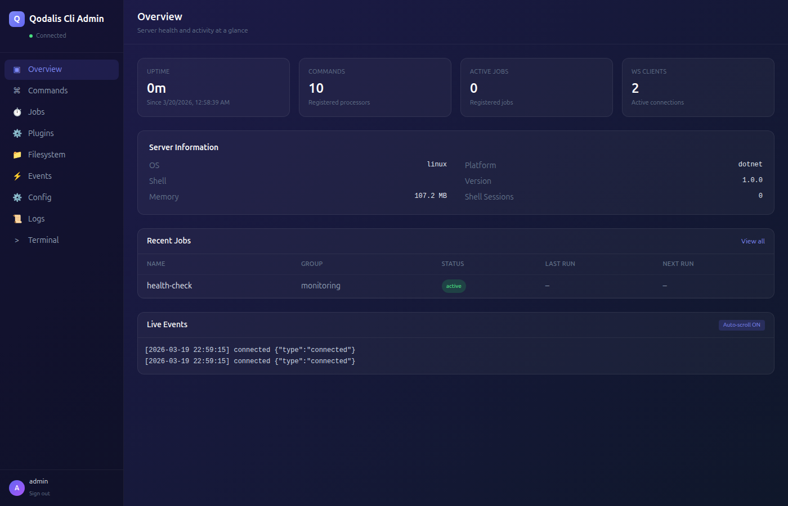

# Qodalis CLI Server Dashboard

The admin dashboard for Qodalis CLI servers: a React single-page app that each server's admin plugin serves at `/qcli/admin`.

[](https://www.npmjs.com/package/@qodalis/cli-server-dashboard)
[](https://github.com/qodalis-solutions/cli-server-dashboard/actions/workflows/build.yml)



## What it is

You do not run the dashboard on its own. It ships as the npm package `@qodalis/cli-server-dashboard` (static files in
`dist/`), and the admin plugin of each Qodalis CLI server copies those files and serves them next to its API.

| Repository | Role |
| --- | --- |
| [web-cli](https://github.com/qodalis-solutions/web-cli) | The browser terminal engine with Angular, React and Vue wrappers and plugins. The dashboard's Terminal page uses `@qodalis/react-cli`. |
| [cli-server-node](https://github.com/qodalis-solutions/cli-server-node), [cli-server-dotnet](https://github.com/qodalis-solutions/cli-server-dotnet), [cli-server-python](https://github.com/qodalis-solutions/cli-server-python) | The servers. Their admin plugins serve this dashboard and its API. |
| **cli-server-dashboard** | This repository. |
| [mcp-cli](https://github.com/qodalis-solutions/mcp-cli) | Local MCP server that connects Claude Code to a CLI server. |
| [pwa-cli](https://github.com/qodalis-solutions/pwa-cli) | The CLI as an installable PWA and Android app. |

## Pages

| Page | Contents |
| --- | --- |
| Overview | Server health, uptime, memory, connections, enabled features |
| Commands | Registered command processors |
| Plugins | Installed modules, their commands, enable or disable a module |
| Terminal | Embedded CLI terminal signed in with the dashboard session |
| Jobs | Background jobs: status, history, trigger, pause, resume, stop, cancel |
| Filesystem | Browse, upload, download and delete files (when the server enables the filesystem API) |
| Events | Live WebSocket event stream and connected clients |
| Config | Server configuration sections; mutable settings can be changed |
| Logs | Server logs with level filter and search |

A failing page or panel shows its error in place, with **Retry**, instead of taking down the whole dashboard.

## Enabling it on a server

Each admin plugin mounts the API under `/api/v1/qcli` and the dashboard under `/qcli/admin`.

**Node.js** (`@qodalis/cli-server-plugin-admin`)

```typescript
import { createCliServer } from '@qodalis/cli-server-node';
import { CliAdminBuilder } from '@qodalis/cli-server-plugin-admin';

const { registry, builder, executor, eventSocketManager, mountPlugin } = createCliServer({ /* ... */ });

const adminPlugin = new CliAdminBuilder()
    .setCredentials('admin', 'a-strong-password') // or .setAuthProvider(usersPlugin.serverAuth)
    .build({ registry, eventSocketManager, builder, executor });

mountPlugin(adminPlugin);
```

**.NET** (`Qodalis.Cli.Plugin.Admin`)

```csharp
builder.Services.AddCli(cli =>
{
    cli.AddAdmin();
});

// After UseWebSockets() and before MapControllers()
app.UseQodalisAdmin();
```

**Python** (`qodalis-cli-server-plugin-admin`)

```python
from qodalis_cli_admin import AdminBuildDeps, CliAdminBuilder

admin_plugin = (
    CliAdminBuilder()
    .set_credentials("admin", "a-strong-password")  # or .set_users_plugin(users_plugin)
    .build(AdminBuildDeps(
        registry=result.registry,
        event_socket_manager=result.event_socket_manager,
        builder=result.builder,
    ))
)
result.mount_plugin(admin_plugin)
```

Then open `http://<server>/qcli/admin`. See each server's admin plugin README for every option.

### Sign-in

| Server setup | How you sign in |
| --- | --- |
| With the users plugin (protected server) | A server account with the `admin:access` permission. Members of `admin` have it; grant it to another group with `groupmod ops --grant=admin:access`. |
| Without the users plugin | The admin plugin's own credentials, set in code or through the variables below. |

| Variable | Default | Purpose |
| --- | --- | --- |
| `QCLI_ADMIN_USERNAME` | `admin` | Admin user name |
| `QCLI_ADMIN_PASSWORD` | `admin` | Admin password |
| `QCLI_ADMIN_JWT_SECRET` | random per start | Secret that signs dashboard tokens |

The servers log a warning at startup while the default credentials are in use. Change them for anything that is not a
local test.

### Security

- On protected servers the dashboard token is a server session: **Sign out** ends it
  (`DELETE /api/v1/qcli/sessions/current`), and revoking the session elsewhere (`session-kick`, disabling the user)
  signs the dashboard out on its next request.
- WebSocket connections (events, terminal) on protected servers never put the token in the URL. Each connection
  first gets a single-use ticket from `POST /api/v1/qcli/sessions/ws-ticket`. Servers without the users plugin still
  accept `?token=`.
- The dashboard is served from the server's own origin, so no CORS configuration is needed.
- `ssh` from the embedded terminal follows the server's remote shell policy; see the server READMEs.

## Admin API

The admin plugins expose these endpoints under `/api/v1/qcli`. Everything except login requires a token.

| Endpoint | Method | Purpose |
| --- | --- | --- |
| `/auth/login` | POST | Sign in, returns a token |
| `/auth/me` | GET | Current user |
| `/status` | GET | Health, uptime, memory, connections, features |
| `/config` | GET, PUT | Read configuration sections, update mutable settings |
| `/plugins` | GET | Registered modules and their processors |
| `/plugins/:id/toggle` | POST | Enable or disable a module |
| `/logs` | GET | Query logs (`level`, `search`, `limit`, `offset`) |
| `/ws/clients` | GET | Connected WebSocket clients |

The other pages use the standard server API (`/api/v1/qcli/commands`, `/api/v1/qcli/jobs`, `/api/qcli/fs/*`,
`/ws/v1/qcli/events`).

## Languages

English, Español, Français, Deutsch, Português, Italiano, 日本語, 한국어, 中文 and Русский. The dashboard starts in the
browser's language (English otherwise); the picker under **Sign out** changes it and the choice is remembered per
browser. Dates, numbers and relative times follow the language, and the embedded terminal switches too through the CLI
language packs (`@qodalis/cli-lang-*`).

To add or change text:

- Messages live in `src/i18n/messages/<area>.ts`, one file per page with all languages side by side. English is the
  source; a missing translation falls back to English.
- Read them with `const { t } = useI18n()` and `t('jobs.title')`. Keys are type-checked, so a typo fails the build.
- Placeholders: `'{count} entries shown'` with `t('logs.shown', { count })`. Plurals: define `key_one` and `key_other`
  (plus `key_few` / `key_many` where the language needs them) and pass `count`.
- Dates and numbers: `formatDate`, `formatRelative` and `formatNumber` from the same hook.
- A new language goes into `src/i18n/locales.ts` and gets a block in each message file.

## Development

CI builds with Node.js 22.

| Command | What it does |
| --- | --- |
| `npm install` | Install dependencies |
| `npm run dev` | Vite dev server; proxies `/api` and `/ws` to `http://localhost:8047` (Node server) |
| `npm run dev:node` / `dev:dotnet` / `dev:python` | Dev server proxied to port 8047 / 8046 / 8048 |
| `npm run build` | Type-check and build into `dist/` |
| `npm run preview` | Serve the production build |

Any other target works with `VITE_PROXY_TARGET=http://host:port npm run dev`. The app is built for the base path
`/qcli/admin/`.

`dev` and `build` first copy the CLI's optional WebAssembly module from `node_modules/@qodalis/cli` into
`public/assets/wasm/` (`scripts/copy-wasm.mjs`, git-ignored). Without it the terminal falls back to JavaScript.

### How the servers pick up the dashboard

Each admin plugin copies the dashboard at build time. It prefers a sibling checkout of this repository
(`../cli-server-dashboard/dist`, so run `npm run build` here first) and otherwise uses the published npm package.

| Server | Copied by | Served from |
| --- | --- | --- |
| Node.js | `npm run build` in `plugins/admin` (`prebuild` runs `scripts/copy-dashboard.js`) | `plugins/admin/dashboard/` |
| Python | `python scripts/copy_dashboard.py` in `plugins/admin`; also resolved at runtime from `node_modules` or the sibling checkout | `plugins/admin/qodalis_cli_admin/dashboard/` |
| .NET | `dotnet build` of `Qodalis.Cli.Plugin.Admin` (runs `npm install` itself when neither source exists) | Embedded in the plugin assembly (staged in `wwwroot/admin/`) |

The servers' Docker images install the npm package, so they ship the published version. After publishing a new
dashboard, refresh the admin plugins' lockfiles.

## Releases

Pull requests go into `develop`; CI (`build.yml`) runs `npm ci` and `npm run build`. A push to `main` publishes the
`package.json` version to npm (`publish.yml`), skipping versions that already exist.

## Tech stack

React 18, TypeScript, Vite, Tailwind CSS, React Router, `@qodalis/react-cli`.
